# TiendaCry

Proyecto final de Programación Móvil y Web para TiendaCry. Incluye una página web de administración y una aplicación móvil para empleados y socios de un club de beneficios.

## Aplicaciones publicadas

| Aplicación | Dirección |
| --- | --- |
| Frontend web | [https://tiendacry.runasp.net/](https://tiendacry.runasp.net/) |
| Backend API | [https://tiendacry-backend.runasp.net](https://tiendacry-backend.runasp.net) |

## Estructura del proyecto

| Proyecto | Descripción |
| --- | --- |
| `TiendaCry.Backend` | API en ASP.NET Core, reglas de negocio, repositorios, acceso a PostgreSQL, envío de correos y almacenamiento de imágenes. |
| `TiendaCry.Web` | Frontend en Blazor WebAssembly para la administración de la plataforma y las tiendas. |
| `TiendaCry.Mobile` | Aplicación .NET MAUI Blazor Hybrid para empleados y socios. El desarrollo móvil se centra en Android. |
| `TiendaCry.Shared` | DTOs, modelos de formularios y definiciones de autenticación compartidos. |

## Tecnologías

- C# y .NET 10.
- ASP.NET Core y Entity Framework Core con Npgsql y PostgreSQL.
- Blazor WebAssembly y .NET MAUI Blazor Hybrid.
- MudBlazor para los componentes de interfaz.
- JWT y refresh tokens para la autenticación.
- BCrypt para las contraseñas, MailKit para los correos y Serilog para los logs.

## Funcionalidades implementadas

### Autenticación y cuentas

- Registro, inicio y cierre de sesión en web y móvil.
- Verificación del correo mediante un link y modificación del correo aún no verificado.
- Recuperación de contraseña mediante un link enviado por e-mail.
- Cambio obligatorio de contraseña temporal para cuentas generadas por un administrador.
- Renovación de sesión mediante refresh tokens.
- Perfil móvil de empleados y socios, con cambio de correo confirmado por link y cambio de contraseña con confirmación.

La confirmación de correo y el restablecimiento mediante los links se realizan en la web. En móvil, el usuario vuelve a la aplicación después de completar el proceso.

### Administración de TiendaCry en la web

- Alta, listado y baja de usuarios y administradores.
- Consulta de tiendas, revisión de solicitudes, aprobación, rechazo con motivo y baja.
- Consulta de promociones por tienda, revisión de solicitudes, aprobación, rechazo con motivo y cancelación.
- Detalles de promociones con los datos de la tienda y su dirección.
- Alta, consulta, modificación y eliminación de categorías.

Los nombres de categorías se comprueban sin distinguir mayúsculas y minúsculas. Una categoría con tiendas asociadas no puede eliminarse.

### Administración de tiendas en la web

- Solicitud de alta y modificación de solicitudes rechazadas para reenviarlas a revisión.
- Gestión de empleados: incorporar una cuenta existente o crear una nueva con contraseña temporal.
- Baja del vínculo de un empleado sin eliminar su cuenta.
- Creación de promociones con imagen y fechas, consulta de detalles, motivo de rechazo y cancelación.
- Cancelación de relaciones con TiendaCry.

### Aplicación móvil

- Selector de tiendas para empleados y consulta de las promociones vigentes de la tienda elegida.
- Alta automática como socio para usuarios comunes; los empleados pueden elegir convertirse en socios.
- Listado y detalle de promociones vigentes para socios.
- Selección de provincia y ciudad en el perfil del socio.
- Filtro por provincia, mostrando primero las promociones de la ciudad seleccionada. Si no hay ubicación configurada, se solicita seleccionarla.
- Barras inferiores para navegar dentro de los modos empleado y socio.

Salir del modo empleado vuelve al selector y conserva la sesión. Al salir del modo socio, se vuelve al selector si el usuario también es empleado; en caso contrario, se cierra la sesión. El selector incluye un botón para cerrar la sesión.

## Permisos y bajas

El JWT contiene los roles utilizados por la interfaz. El backend valida los permisos y los vínculos con cada tienda antes de permitir las acciones correspondientes.

Las bajas de usuarios, administradores, tiendas y vínculos conservan los registros y el historial. Al dar de baja a un usuario se revocan sus sesiones y sus vínculos activos. Si administra tiendas, también se dan de baja esas tiendas y sus vínculos, y se cancelan sus promociones aprobadas o pendientes. Las cuentas de los otros empleados se conservan.

## Funcionalidades pendientes

- Generación y lectura de códigos QR y registro de canjes de promociones.
- Gestión de membresías e integración de pagos con Mercado Pago.
- Generación, consulta y cancelación de cupones e integración con TiendaNube.
- Estadísticas basadas en los usos de promociones.

Los modelos o botones existentes para estas funcionalidades no implican que sus flujos estén completos.

## Ejecución local

### Requisitos

- SDK de .NET 10.
- PostgreSQL y una base de datos con el esquema correspondiente al proyecto.
- Configuración de JWT y una cuenta SMTP para el envío de correos.
- Para Android: workload de .NET MAUI, Android SDK y un emulador o dispositivo conectado mediante ADB.

### Configuración del backend

En desarrollo, configurar los valores propios del entorno mediante User Secrets del proyecto `TiendaCry.Backend`. En el servidor, utilizar la configuración del entorno de despliegue.

| Sección | Claves |
| --- | --- |
| Base de datos | `ConnectionStrings:DefaultConnection` |
| JWT | `JwtSettings:Key`, `JwtSettings:Issuer`, `JwtSettings:Audience`, `JwtSettings:ExpiryMinutes` |
| SMTP | `EmailSettings:Host`, `EmailSettings:Port`, `EmailSettings:Username`, `EmailSettings:Password` |
| Remitente | `EmailSettings:FromEmail`, `EmailSettings:FromName` |
| Links de correo | `EmailSettings:UrlVerificacion`, `EmailSettings:UrlRecuperacionContrasena` |

Para trabajar con el frontend local, las URLs de los links son:

- Verificación y confirmación de cambio de correo: `https://localhost:7264/verificar-email`.
- Recuperación: `https://localhost:7264/restablecer-contrasena`.

Las credenciales y claves privadas no deben incluirse en el repositorio ni en la configuración pública de Blazor WebAssembly.

Al iniciar el backend se ejecutan los seeders de estados, roles de tienda, categorías, tipos de token de correo y ubicación. Los seeders requieren que el esquema de la base ya exista. La carga inicial de provincias y localidades consulta la API Georef. No se crea automáticamente una cuenta de administrador de TiendaCry: el alta desde la aplicación requiere un administrador existente.

### Backend y web

Desde la raíz de la solución, ejecutar en dos terminales:

```powershell
dotnet run --project TiendaCry.Backend --launch-profile https
```

```powershell
dotnet run --project TiendaCry.Web --launch-profile https
```

- Backend local: `https://localhost:7283`.
- Frontend local: `https://localhost:7264`.
- Documento OpenAPI en Development: `https://localhost:7283/openapi/v1.json`.

La dirección de la API web se define en `TiendaCry.Web/wwwroot/appsettings.Development.json` y `appsettings.Production.json`, bajo `Apis:TiendaCry`. La URL del backend es configuración pública; las credenciales permanecen en el servidor.

### Android

Desde la carpeta `TiendaCry.Mobile`, ejecutar:

```powershell
dotnet build -f net10.0-android -t:Run -c Debug
```

La configuración actual de `MauiProgram.cs` utiliza:

| Configuración | Backend |
| --- | --- |
| Debug | `https://10.0.2.2:7283/`, para acceder al backend de la PC desde el emulador Android. |
| Release | `https://tiendacry-backend.runasp.net/`. |

Para ejecutar en un dispositivo específico:

```powershell
adb devices
dotnet build -f net10.0-android -t:Run -c Release "-p:AdbTarget=-s ID_DEL_DISPOSITIVO"
```

Reemplazar `ID_DEL_DISPOSITIVO` por el identificador que muestra ADB. Un celular físico en Debug necesita una dirección accesible del backend; `10.0.2.2` corresponde al emulador.

La excepción de certificado configurada en Debug se aplica a `HttpClient`. La carga de imágenes del WebView utiliza su propia validación de certificados.

## Sesiones, imágenes y logs

- La web guarda los tokens en `localStorage`; móvil utiliza `SecureStorage`.
- Los archivos de imágenes se almacenan en `TiendaCry.Backend/wwwroot/uploads/promociones`; la tabla `Imagenes` guarda sus metadatos y su relación con la promoción.
- Los logs se escriben diariamente en `Logs/log-.txt`, relativo al directorio de ejecución del backend.
- Las imágenes subidas y los logs están excluidos del control de versiones. Al desplegar, se debe conservar el almacenamiento de imágenes para que las rutas guardadas sigan funcionando.

## Capturas de pruebas

Capturas de la aplicación tomadas durante las pruebas. Algunas corresponden a versiones anteriores de la interfaz. La pantalla de la promoción seleccionada por el empleado muestra el acceso al escaneo, cuya funcionalidad sigue pendiente.

### Página web

#### Panel del administrador de TiendaCry

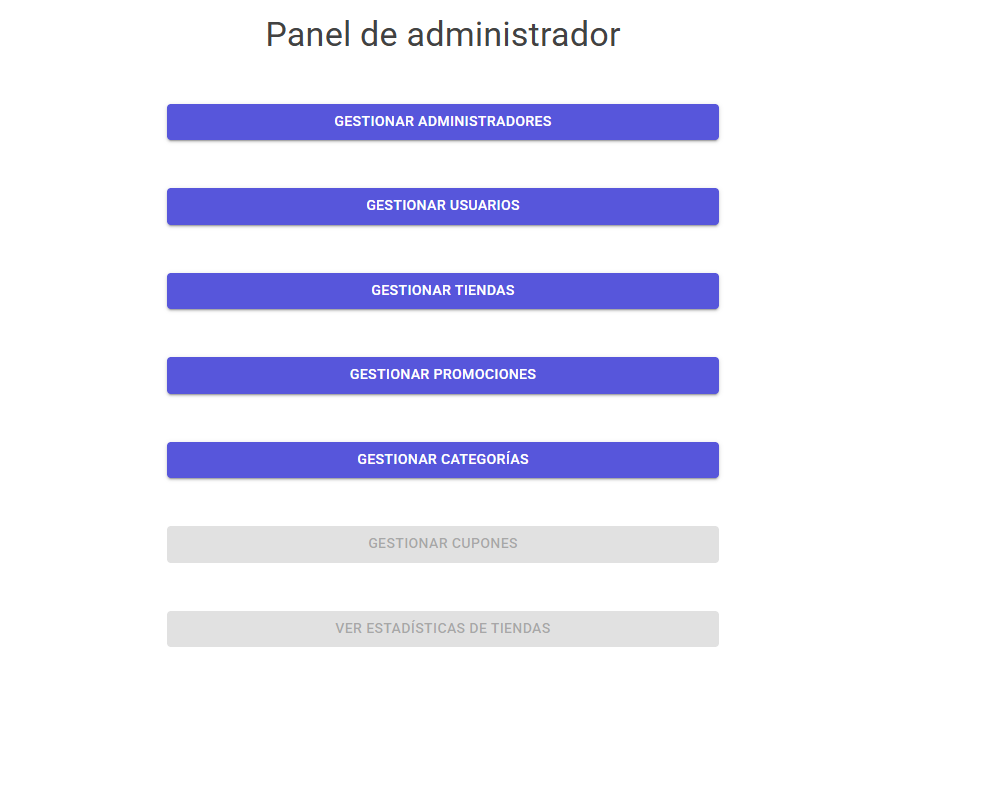

#### Gestión de tiendas

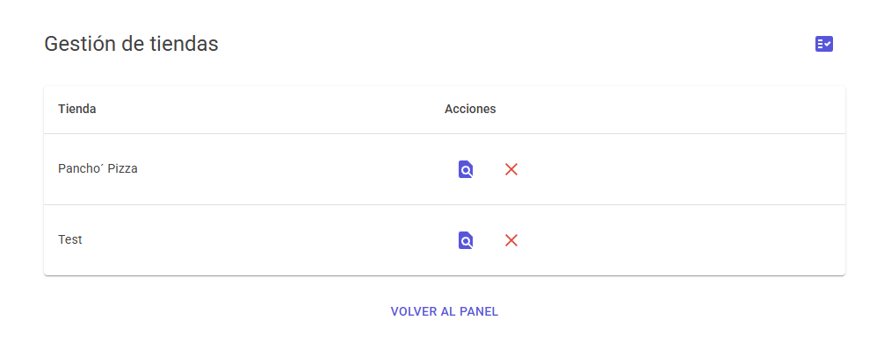

#### Detalles de una tienda

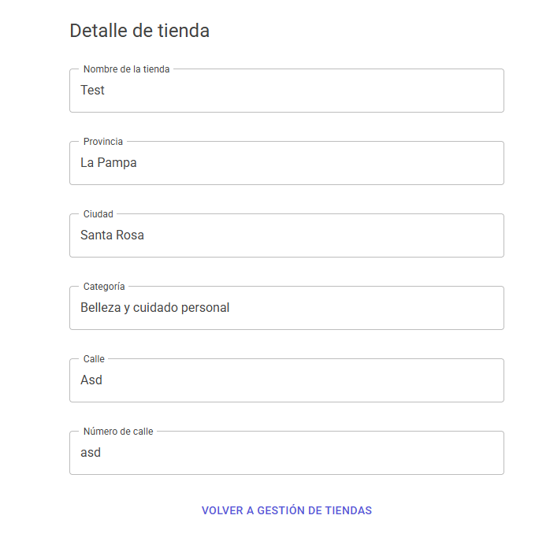

#### Revisión de una promoción pendiente

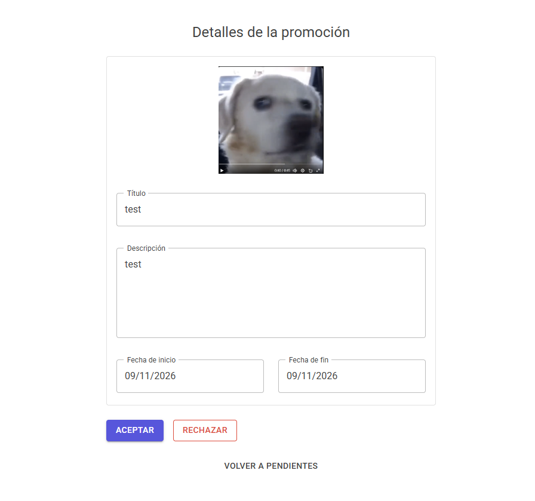

#### Panel del administrador de tienda

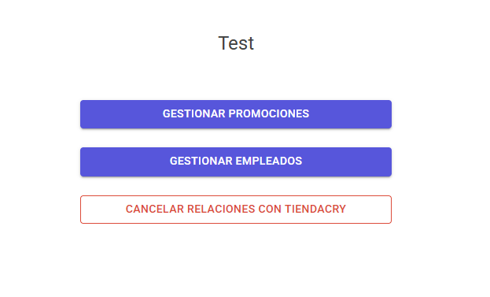

#### Gestión de promociones de la tienda

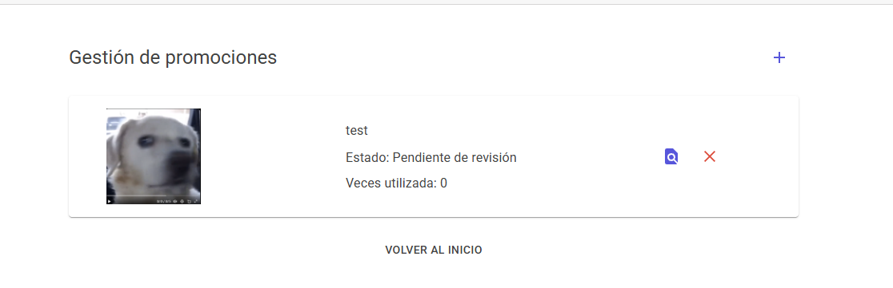

#### Solicitud de alta de una promoción

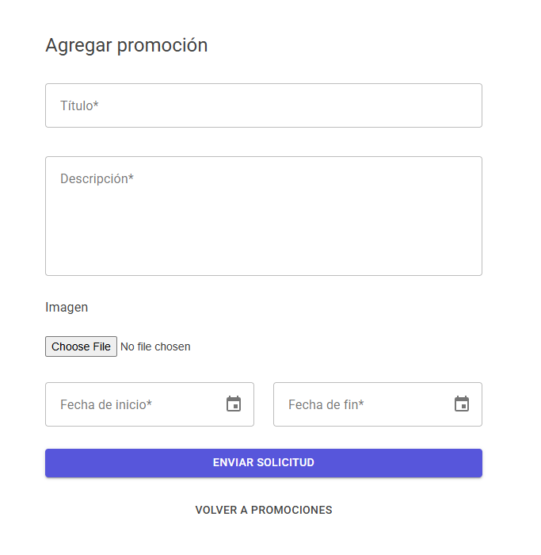

### Aplicación móvil

#### Selección de modo socio o empleado

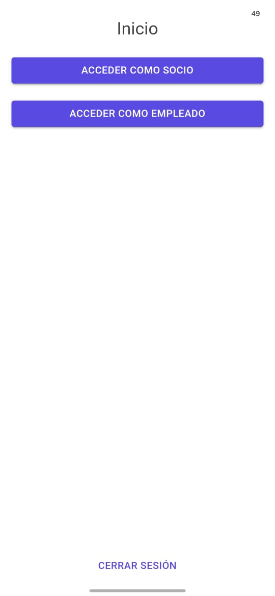

#### Promociones disponibles para el socio

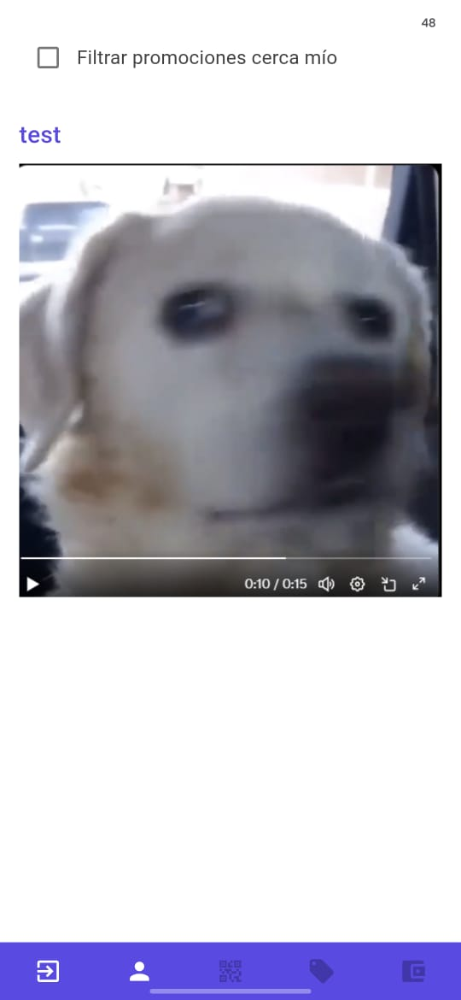

#### Detalle de una promoción para el socio

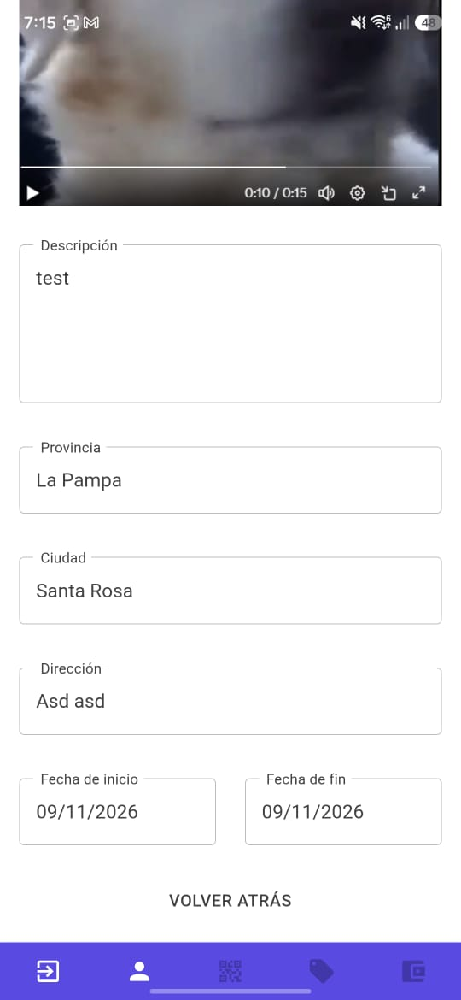

#### Perfil del socio

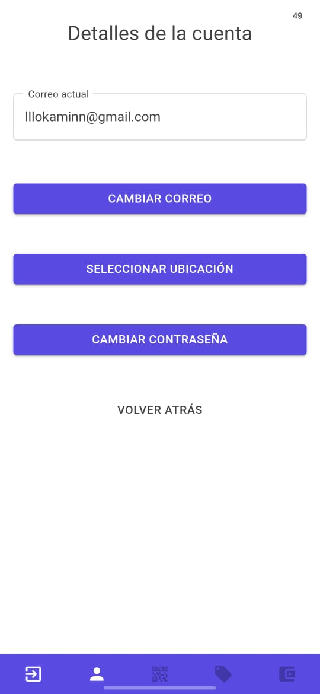

#### Promociones de la tienda para el empleado

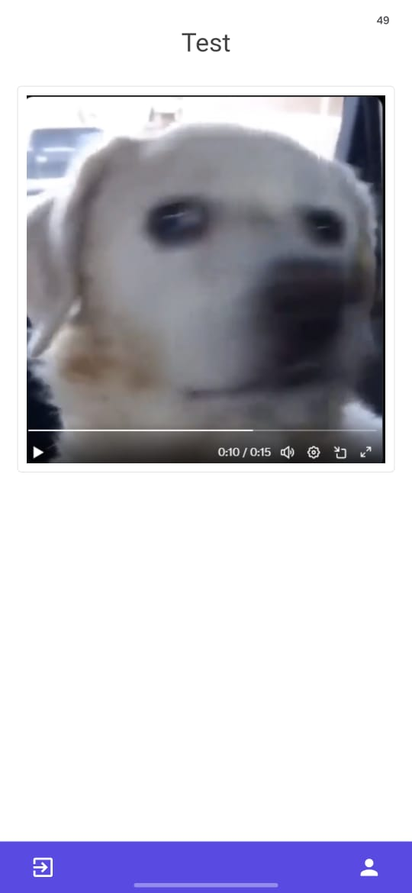

#### Promoción seleccionada por el empleado

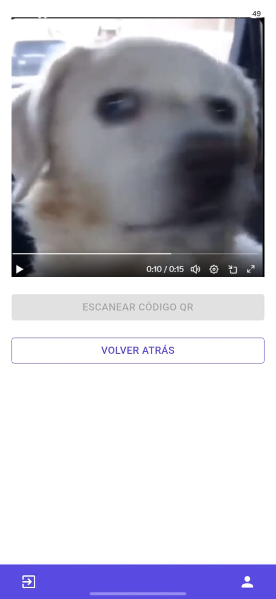
